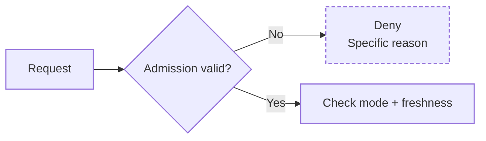
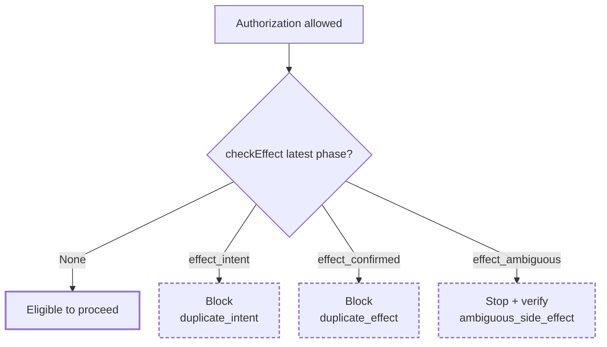

# Agent Policy Core

Giving an agent a tool is easy. Deciding when it should *not* use the tool is where things get interesting.

This JavaScript library is a policy check in front of tool-calling agents. It answers two separate questions:

**1. Are you allowed to do this?** Exact platform/action, URL origin, granted mode, review freshness, and write limits all matter. A URL that merely *looks* like the right domain doesn't get a free pass.

**2. Has this action already happened — or might it have?** A confirmed effect blocks duplicates. An ambiguous effect blocks retries until someone checks. A successful permission check does **not** override an uncertain effect ledger.

So yes, the agent can have permission to click a button and still be told to leave it alone. That's the entire joke, and also the safety feature.

## Two gates. Two different reasons to stop.

First, the requested action has to be inside the approved scope.

Even with permission, an earlier uncertain effect can still stop a retry.

Node.js 20+; [the walkthrough and tests](docs/verification.md) exercise these choices, including the refusal paths.

Where to look:

- [registry.js](src/registry.js) — reviewed platforms, actions, modes, and limits
- [policy.js](src/policy.js) — admission and scope narrowing
- [dedupe.js](src/dedupe.js) — duplicate content and unresolved-effect blocking
- [journal.js](src/journal.js) — recorded effect evidence with redaction
- [tests](test/) — behavior, including refusal paths

The exact admission-order and error contracts live in [invariants](docs/invariants.md) and [failure modes](docs/failure-modes.md).

## What isn't hiding in here

No browser driver, provider client, credentials, or magic sandbox. The calling application has to place this gate in front of its actual tools and persist the journal correctly. This repo doesn't prove a deployment is secure just because the library has opinions. [Security](SECURITY.md) · [verification](docs/verification.md) · [provenance](PROVENANCE.md).
